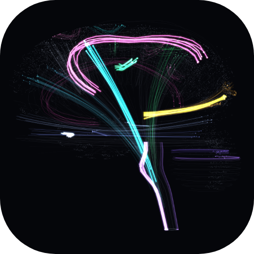
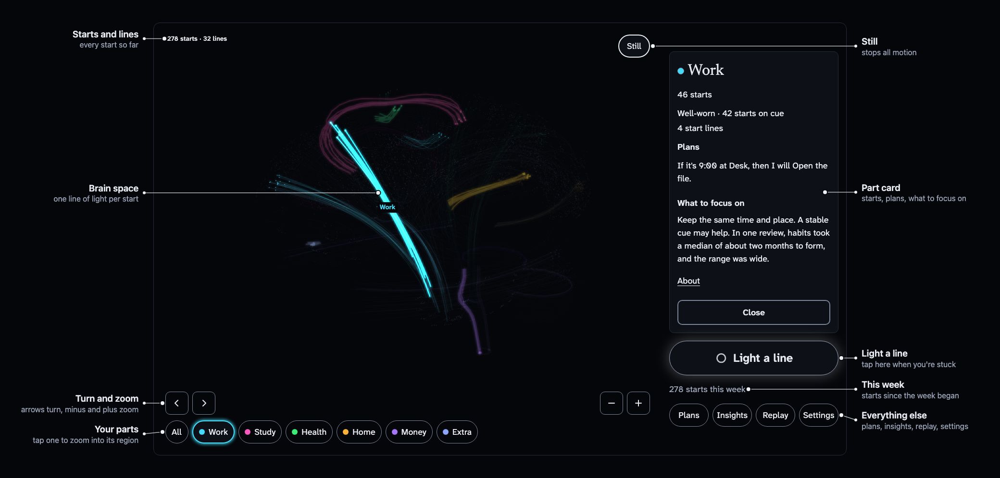
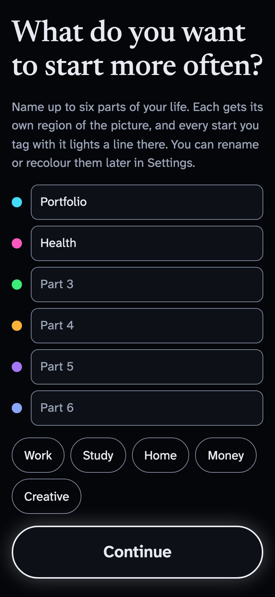
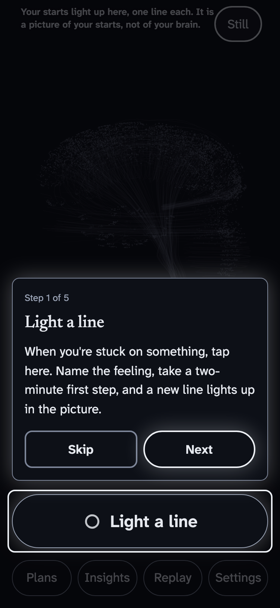
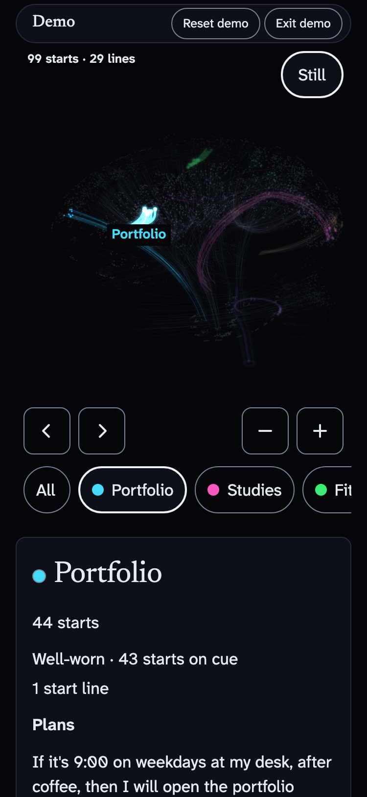
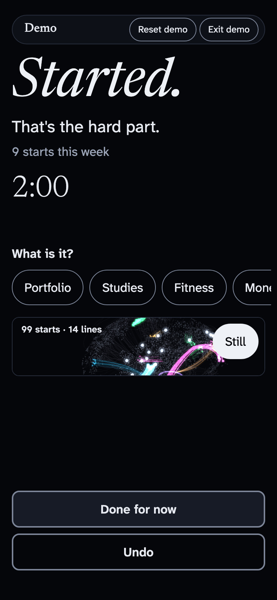
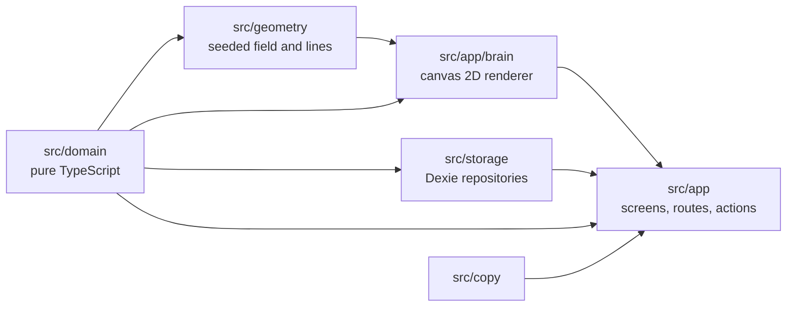

<a id="readme-top"></a>

[](https://github.com/shreyandhawa/arohexis)
[](https://arohexis.arohexis.workers.dev/welcome)
[](#about-the-project)
[](#about-the-project)
[](https://github.com/shreyandhawa/arohexis/issues)
[](https://github.com/shreyandhawa/arohexis/commits/main)

<br />
<div align="center">
  <a href="https://github.com/shreyandhawa/arohexis">
    
  </a>

<h3 align="center">Arohexis</h3>

  <p align="center">
    A local-first app that trains the moment of starting.
    <br />
    <a href="docs/spec.md"><strong>Explore the docs »</strong></a>
    <br />
    <br />
    <a href="https://arohexis.arohexis.workers.dev/welcome">View Demo</a>
    &middot;
    <a href="https://github.com/shreyandhawa/arohexis/issues/new?labels=bug">Report Bug</a>
    &middot;
    <a href="https://github.com/shreyandhawa/arohexis/issues/new?labels=enhancement">Request Feature</a>
  </p>
</div>

<details>
  <summary>Table of Contents</summary>
  <ol>
    <li>
      <a href="#about-the-project">About The Project</a>
      <ul>
        <li><a href="#built-with">Built With</a></li>
      </ul>
    </li>
    <li>
      <a href="#getting-started">Getting Started</a>
      <ul>
        <li><a href="#prerequisites">Prerequisites</a></li>
        <li><a href="#installation">Installation</a></li>
      </ul>
    </li>
    <li><a href="#usage">Usage</a></li>
    <li><a href="#architecture">Architecture</a></li>
    <li><a href="#roadmap">Roadmap</a></li>
    <li><a href="#license">License</a></li>
    <li><a href="#contact">Contact</a></li>
  </ol>
</details>

## About The Project

GitHub: [github.com/shreyandhawa/arohexis](https://github.com/shreyandhawa/arohexis)

[](https://arohexis.arohexis.workers.dev/welcome)

Arohexis is an installable web app for people who put things off. It has no task list. It helps with one moment: the start. When you're stuck, you tap Light a line, name what you're feeling, and take a two-minute first step. Each start lights a line in a picture shaped like a brain.

Here's why:

- Starting is the hard part, so the app trains that one moment and nothing else.
- You see your starts add up. Every start lights a line, and a plan's line grows thicker each time you start at its time and place. The logo above is what that looks like after weeks of steady starts.
- Your data stays on your device. There are no accounts, no tracking and no requests to other sites, and it works offline.

Arohexis is a self-help tool, not medical advice, and it doesn't diagnose or treat any condition.

<p align="right">(<a href="#readme-top">back to top</a>)</p>

### Built With

[](https://react.dev/)
[](https://www.typescriptlang.org/)
[](https://vite.dev/)
[](https://dexie.org/)
[](https://valibot.dev/)
[](https://vitest.dev/)
[](https://playwright.dev/)

<p align="right">(<a href="#readme-top">back to top</a>)</p>

## Getting Started

To run a copy locally, follow these steps.

### Prerequisites

- Node 26 (the version in `.nvmrc`)
- npm

### Installation

1. Clone the repo
   ```sh
   git clone https://github.com/shreyandhawa/arohexis.git
   ```
2. Install the packages
   ```sh
   npm install
   ```
3. Start the dev server, then open the address it prints
   ```sh
   npm run dev
   ```
4. Run the tests
   ```sh
   npm test
   ```

To install it on a phone, open the app in Safari on iPhone and tap Share, then Add to Home Screen. On Android and desktop, use the browser's install option.

<p align="right">(<a href="#readme-top">back to top</a>)</p>

## Usage

|                                           1. Name your parts                                            |                                        2. Follow the walkthrough                                        |                                         3. Tap a part to zoom in                                          |                                    4. Start, and a line lights up                                     |
| :-----------------------------------------------------------------------------------------------------: | :-----------------------------------------------------------------------------------------------------: | :-------------------------------------------------------------------------------------------------------: | :---------------------------------------------------------------------------------------------------: |
|  |  |  |  |

1. **Name your parts.** The first time you open Arohexis, name up to six parts of your life, such as Work or Study. Each gets its own region of the picture.
2. **Follow the walkthrough.** Home shows what each control does, once. You can see it again from About.
3. **Tap a part.** The picture zooms into that part's region, and its card shows your starts, plans and what to focus on. All zooms back out.
4. **Light a line when you're stuck.** Name the feeling, read a short response, and take a two-minute first step. The new line lights up.

Still stops all motion. Replay plays your starts back in order, and Insights shows your patterns by week and hour.

Watch [the short demo](docs/media/demo.webm), or open the [live demo](https://arohexis.arohexis.workers.dev/welcome) and tap Explore the demo to see ten weeks of made-up starts. The demo uses its own database and never touches yours.

<p align="right">(<a href="#readme-top">back to top</a>)</p>

## Architecture



Arrows point from the imported layer to the one that imports it.

- `src/domain`: events, attempts and projections such as `projectBrainSpace`. Pure TypeScript with no React, storage, DOM or network.
- `src/geometry`: the seeded brain-shaped field and where each line goes.
- `src/storage`: the Dexie database in IndexedDB and its repositories.
- `src/app/brain`: the canvas 2D renderer for Brain space, loaded on demand.
- `src/app`: routes, screens and the actions that write events.
- `src/copy`: every user-facing string, checked by a test.

The full design is in [docs/spec.md](docs/spec.md), and the reasons for each decision are in [docs/decisions.md](docs/decisions.md).

<p align="right">(<a href="#readme-top">back to top</a>)</p>

## Roadmap

- [x] Light a line: one button, a feeling, a two-minute first step
- [x] Brain space, Replay and Insights
- [x] If-then plans with Add to calendar
- [x] Every start lights a line
- [x] Setup, a Home walkthrough, and parts that zoom
- [ ] The two-week trial and its pass line ([docs/trial.md](docs/trial.md))
- [ ] Push reminders, if the trial shows the calendar cue isn't enough

See the [open issues](https://github.com/shreyandhawa/arohexis/issues) for proposed features and known issues.

<p align="right">(<a href="#readme-top">back to top</a>)</p>

## License

No licence file is present, so all rights are reserved.

<p align="right">(<a href="#readme-top">back to top</a>)</p>

## Contact

[@shreyandhawa](https://github.com/shreyandhawa) on GitHub

Project link: [github.com/shreyandhawa/arohexis](https://github.com/shreyandhawa/arohexis)

<p align="right">(<a href="#readme-top">back to top</a>)</p>
